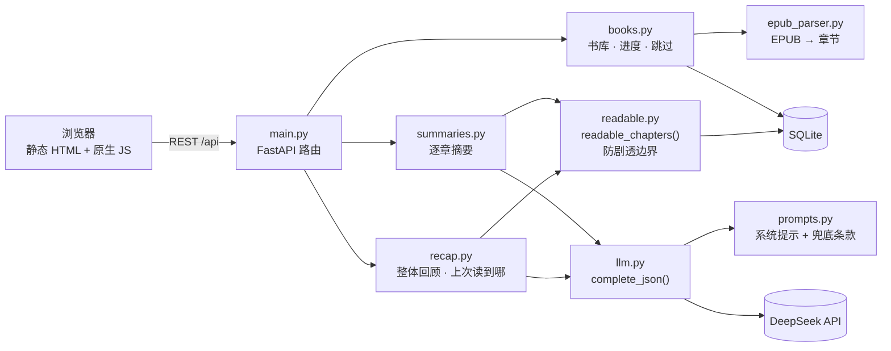

# EPUB 读书伴侣

> 读到哪，提要就只讲到哪。

一本书放下几天再拿起来，常常想不起前面发生了什么；去网上搜剧情梗概，又很容易被剧透。
**EPUB 读书伴侣**让你导入自己的 EPUB、告诉它"正在读第几章"，它会用大模型只根据**已经读过的章节**写出前情提要，**绝不剧透未读内容**。

<!-- 截图占位：把图片放到 docs/screenshots/ 下，替换下面的路径 -->
| 书架 | 前情提要 | 章节与进度 |
|---|---|---|
|  |  |  |

<!-- 可选：夜间主题 / 手机截图 -->
<!--  -->

## 功能

**书库**
- 上传 `.epub` 导入（支持拖放、一次多本），解析书名、作者、封面和章节
- 按 EPUB 目录（EPUB3 nav / EPUB2 NCX）切分章节，嵌套目录展平，显示"第一卷 · 第三章"这样的完整标题；没有目录时按文件分章
- 识别 DRM 加密和损坏的文件，给出明确提示；只做了字体混淆的书可以正常导入
- 删除书籍时连同文件、进度和摘要一起删除

**进度**
- 在章节列表里选择"正在读的章节"，每本书独立记录
- 序言、版权页、致谢等非正文可以勾选跳过；正文同时出现书名和作者的短页面（版权页、扉页）导入时自动跳过
- 未读章节的标题默认模糊显示，点一下才看得到，扫一眼目录也不会被剧透

**前情提要**
- **上次读到哪**：最近读完的一两章的摘要，突出最后一章结束时的状态，帮你接上断点（直接用缓存，不调用模型）
- **整体回顾**：把已读章节归并成 2~4 段的"提醒"，而不是逐章复述
- **逐章摘要**：每章一条，可展开查看、单独重新生成；按需生成并缓存，生成时显示进度，可暂停 / 继续
- **读完这一章**：一键让进度前进一章，自动补上新章节的摘要并刷新回顾，可撤销
- 超长章节自动切块分别摘要再合并；书很长、摘要总量超出上下文时，整体回顾先分组汇总再合并
- 英文书也输出中文提要，人名、地名首次出现时附原文

**阅读体验**
- 纸张 / 护眼 / 夜间三套主题，或跟随系统；正文字号可调
- 衬线正文排版，适配手机屏幕

## 防剧透是怎么做到的

这是这个项目的第一约束，代码里从几个层面守住它：

1. **唯一入口**：发给模型的章节正文只能经由 [`readable_chapters()`](app/readable.py) 取得，它只返回第 1 ~ N-1 章中没被跳过的章节。[守护测试](tests/test_readable.py)会扫描整个 `app/` 目录，任何其他地方 `SELECT` 章节正文都会让测试失败。
2. **上下文也不越界**：生成第 k 章摘要时，只带第 k 章之前最近几章的摘要，以及由前 k-1 章合并出的人物名单；重新生成某章时不会把后面章节的信息带进来。
3. **不给模型提示**：不传书名、作者等元数据；版权页这类正文里写着书名和作者的页面默认跳过。模型在人物名单里"补"出原文中不存在的外文原名时会被丢弃，因为那只可能来自模型对这本书的记忆。
4. **名著兜底条款**：所有请求的系统提示都由同一个函数拼出，统一带上"当作第一次读、不预告后续、不补充文本外的信息"等规则（[`prompts.py`](app/prompts.py)）。
5. **可审计**：开发模式下每个发给模型的请求都完整记录到 `DATA_DIR/logs/llm_requests.jsonl`（不含 API key 和请求头），可以人工核查有没有越界。
6. **测试书带标记**：自动化测试用的 EPUB 现场生成，每章正文里都有唯一标记 `MARKER_CHnn`，测试通过搜索这些标记判断请求里有没有混进未读章节。

## 技术栈

| 层 | 选择 |
|---|---|
| 后端 | Python 3.11+、FastAPI、Uvicorn |
| EPUB 解析 | ebooklib、BeautifulSoup、lxml |
| 存储 | SQLite（标准库 `sqlite3`，不用 ORM）+ 本地目录存放 EPUB 和封面 |
| 大模型 | DeepSeek（通过 OpenAI 兼容接口，JSON 输出模式） |
| 前端 | 静态 HTML + 原生 JavaScript + CSS，无框架、无构建步骤 |
| 测试 / 代码质量 | pytest、ruff |

## 架构



几个关键设计：

- **章节切分**（`epub_parser.py`）：先把整本书按阅读顺序摊平成一串文本片段，记下每个文件起点和每个锚点的位置；章节就是"从本目录项的位置到下一个目录项的位置"的切片。这样同一个文件里有多章、一章跨好几个文件的情况都用同一套逻辑处理。带链接的卷首页也算边界但不成章，卷名不会混进上一章末尾。
- **逐章生成**：后一章的摘要要用前面章节的摘要作上下文，所以由前端循环调用 `POST .../summaries/next`，一次生成一章。实现简单、天然有进度显示，中途关掉页面也不会丢掉已生成的章节。
- **回顾缓存**：缓存键是"进度 N + 参与各章摘要内容的哈希"。改进度、勾选跳过、重新生成任一章摘要，缓存都会自然失效，不需要手动清理。
- **模型调用**：统一经由 `llm.complete_json()`，负责 JSON 解析、内容不合格时重试一次、开发模式日志；模型客户端通过 FastAPI 依赖注入，测试时换成记录请求的假模型，测试从不调用真实模型。
- **为多用户预留**：所有表都有 `user_id`，查询都带上这个条件；目前固定为单一默认用户。

```
app/
  main.py          FastAPI 路由和依赖
  config.py        从环境变量读配置
  db.py            SQLite 连接和建表
  epub_parser.py   EPUB → 元数据 + 展平后的章节
  books.py         书库增删查、进度、跳过
  readable.py      readable_chapters：防剧透边界
  summaries.py     逐章摘要：上下文、切块、缓存
  recap.py         整体回顾、上次读到哪
  llm.py           模型调用封装、开发日志
  prompts.py       所有 prompt
  static/          前端页面（index / book / summary）、js/、style.css
tests/             pytest；epub_builder.py 现场生成测试用 EPUB
docs/              需求规格（spec.md）和分阶段实施计划（plan.md）
```

## 快速开始

需要 Python 3.11 或更高版本。

```bash
python3 -m venv .venv
```

```bash
.venv/bin/pip install -r requirements.txt
```

```bash
cp .env.example .env
```

在 `.env` 里填上 `DEEPSEEK_API_KEY`，然后启动：

```bash
.venv/bin/python -m app
```

打开 <http://127.0.0.1:8000>。没有配置 key 也能导入书、设置进度，只是不能生成摘要。接口文档在 <http://127.0.0.1:8000/docs>。

### 配置

所有配置都走环境变量（本地开发可以写在 `.env` 里），留空的项使用默认值。

| 变量 | 默认值 | 说明 |
|---|---|---|
| `DEEPSEEK_API_KEY` | — | DeepSeek API key，生成摘要必需 |
| `DEEPSEEK_BASE_URL` | `https://api.deepseek.com` | OpenAI 兼容接口地址 |
| `DEEPSEEK_MODEL` | `deepseek-chat` | 模型名 |
| `DATA_DIR` | `./data` | SQLite 数据库、导入的 EPUB、封面、日志都放在这里 |
| `HOST` / `PORT` | `127.0.0.1` / `8000` | 监听地址 |
| `APP_ENV` | `production` | 设为 `development` 时自动重载代码，并记录发给模型的请求 |
| `SUMMARY_CONTEXT_CHAPTERS` | `3` | 生成逐章摘要时带入的最近已读章节数 |
| `CORS_ORIGINS` | 空 | 前端单独部署到其他域名时填写，逗号分隔 |

### 用 Docker 部署

```bash
docker build -t epub-companion .
```

```bash
docker run -d -p 8000:8000 -v "$PWD/data:/data" --env-file .env epub-companion
```

单进程运行，所有数据都在挂载的 `/data` 里，备份这个目录即可。镜像带有基于 `GET /api/health` 的健康检查。

### 前端单独部署

前端是纯静态文件，也可以和后端分开部署：把 `app/static/` 发布到静态托管，在三个页面的 `<meta name="api-base">` 里填上后端地址，并在后端的 `CORS_ORIGINS` 里加上前端的域名。

## 接口

| 方法 | 路径 | 说明 |
|---|---|---|
| GET | `/api/health` | 存活检查，返回是否已配置模型 key |
| GET | `/api/books` | 书架列表 |
| POST | `/api/books` | 上传并导入 EPUB（`multipart/form-data`，字段 `file`） |
| GET | `/api/books/{id}` | 书的信息和章节列表（不含正文） |
| DELETE | `/api/books/{id}` | 删除书籍及其文件、摘要 |
| GET | `/api/books/{id}/cover` | 封面图片 |
| PUT | `/api/books/{id}/progress` | 设置正在读的章节 `{"chapter": N}` |
| PUT | `/api/books/{id}/chapters/{n}/skipped` | 设置是否跳过 `{"skipped": true}` |
| GET | `/api/books/{id}/summaries` | 已读章节的摘要，以及还缺几章 |
| POST | `/api/books/{id}/summaries/next` | 生成下一个缺失的章节摘要 |
| POST | `/api/books/{id}/chapters/{n}/summary/regenerate` | 重新生成某章摘要 |
| GET | `/api/books/{id}/recap` | 整体回顾（有缓存直接返回） |
| GET | `/api/books/{id}/last-read` | 上次读到哪 |

## 开发

```bash
.venv/bin/pip install -r requirements-dev.txt
```

```bash
.venv/bin/pytest
```

```bash
.venv/bin/ruff format . && .venv/bin/ruff check .
```

测试不会调用真实模型，也不依赖外部文件：测试用的 EPUB 由 `tests/epub_builder.py` 现场生成，模型由 `tests/conftest.py` 里的假模型代替。

手动验证用的真实书可以放在 `samples/` 下，这个目录已加入 `.gitignore`，不会被提交。

## 路线图

以下是计划中、**尚未实现**的功能（见 [docs/spec.md](docs/spec.md)）：

- 人物表
- 基于已读内容的问答（复用同一个 `readable_chapters` 边界）
- 登录与多用户
